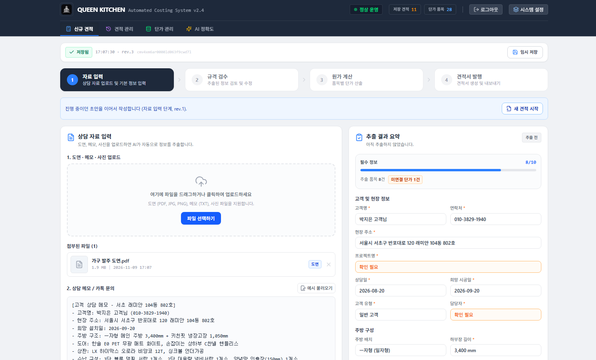
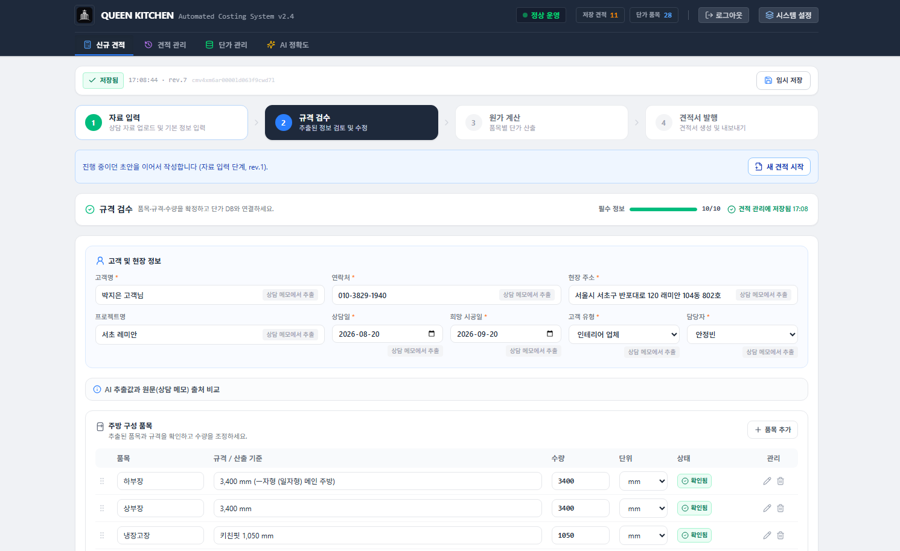
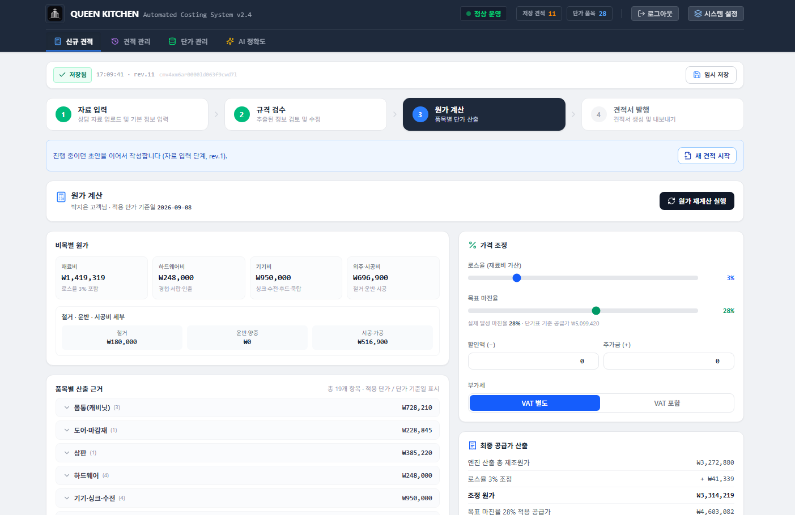
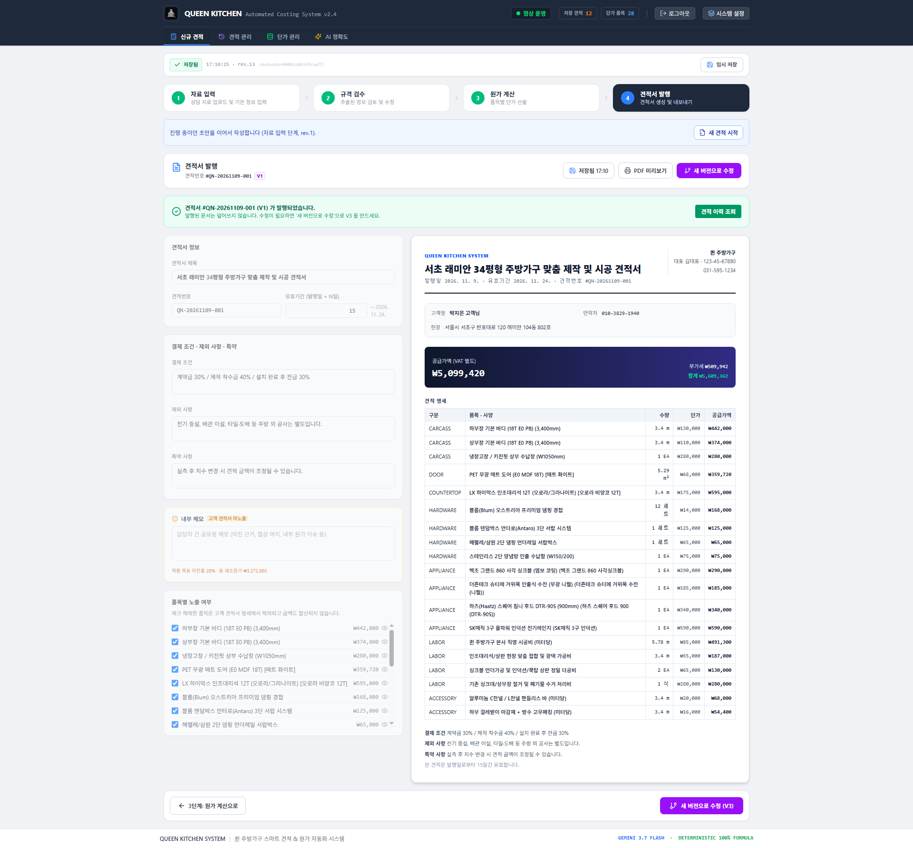

# Queen-OS

> 흩어진 상담 자료를 **검수 가능한 주문 정보 → 근거가 보이는 원가 → 버전이 남는 견적서**로 연결하는 주방가구 B2B 견적 운영 시스템입니다.

[라이브 데모](https://queen-os-theta.vercel.app/) · [프로젝트 발표 자료](https://github.com/user-attachments/files/32230893/OS_B2B.SaaS.Project.pdf) · [기술규격서](docs/기술규격서.md)

> 데모 계정과 비밀번호는 저장소에 공개하지 않습니다. 인증 정보는 배포 환경에서 별도로 관리합니다.

## 프로젝트 한눈에 보기

| 구분 | 내용 |
| --- | --- |
| 프로젝트 유형 | 주방가구 주문·견적 관리 B2B SaaS |
| 목표 사용자 | 상담 자료를 바탕으로 원가와 고객 견적을 작성하는 영업·설계·견적 실무자 |
| 해결하려는 문제 | 자료 재입력, 수기 계산 오류, 단가 변경 누락, 견적 버전 혼선 |
| 핵심 경험 | AI 입력 보조 → 사람의 규격 검수 → 결정론적 계산 → 근거와 버전이 남는 발행 |
| 주요 범위 | 문서 추출, 주문 검수, 단가표, 원가 계산, 자동 저장, 견적 이력, 파싱 품질 측정 |
| 기술 | React, TypeScript, Express, Prisma, Supabase PostgreSQL, Gemini, Zod, Vitest |
| 현재 단계 | 배포 가능한 프로토타입 · 실제 운영 KPI 측정 전 |

## 왜 만들었나

주방가구 견적은 고객 메모, 도면, 사진, PDF처럼 형식이 다른 자료에서 시작합니다. 담당자는 이 자료를 다시 읽고 규격과 옵션을 옮긴 뒤, 단가표와 현장 조건을 대조해 원가와 마진을 계산해야 합니다.

이 과정에서는 세 가지 문제가 반복됩니다.

- 같은 정보를 여러 화면과 문서에 다시 입력한다.
- 계산 결과가 나와도 어떤 규격과 단가가 적용됐는지 확인하기 어렵다.
- 단가나 조건이 바뀐 뒤에도 이전 견적이 덮어써져 판단 근거가 사라진다.

Queen-OS는 입력 속도만 높이는 대신, **사람이 확인할 지점과 계산의 책임 경계를 분명히 하는 것**에 초점을 맞췄습니다.

## 현장 도입 원칙

기존 업무 방식을 한 번에 바꾸는 대신, 현장 직원은 익숙한 카톡·전화·손도면을 계속 사용하고 관리자가 Queen-OS에서 정보를 정리하는 방식으로 설계했습니다.

- 현장 직원: 상담과 실측 자료를 기존 방식으로 전달
- 관리자: 원본 자료를 모아 AI 초안을 만들고 확정 사양으로 정리
- 계산 엔진: 사람이 확인한 값과 단가표만 사용해 원가·견적 산출
- 이카운트: 확정 주문 이후의 매입·매출·회계·재고를 담당하도록 업무 경계를 분리

이카운트 연동은 코드 매핑과 주문 전송, 실제 비용 회수를 위한 다음 단계이며 현재 구현 완료 기능으로 간주하지 않습니다.

## 핵심 업무 흐름

```text
상담 자료 입력
   ↓
AI 정보 추출 ── 빠른 초안 생성
   ↓
사람의 규격·옵션 검수 ── 누락과 오인식 수정
   ↓
단가표 기반 원가 계산 ── 항목별 공식과 적용 단가 표시
   ↓
마진·할인·부가세 확인
   ↓
견적서 발행 ── V1 / V2 / V3 이력 보존
```

AI는 입력을 돕지만 가격을 결정하지 않습니다. 원가와 판매가는 [`server/calculationEngine.ts`](server/calculationEngine.ts)의 결정론적 엔진이 단가표 DB와 명시된 규칙을 기준으로 계산합니다.

## 실제 화면

### 1. 자료 입력



원본 파일과 상담 메모를 한 화면에서 관리하고, AI가 추출한 고객·현장·주방 정보를 오른쪽에서 바로 확인합니다. 필수 값이 비어 있으면 `확인 필요`로 표시해 다음 단계로 누락이 넘어가지 않게 합니다.

### 2. 규격 검수



AI 추출값과 원문 출처를 비교하고, 고객 정보와 품목별 규격·수량을 사람이 확정합니다. 단가표에 연결된 값과 아직 확인되지 않은 값을 시각적으로 구분합니다.

### 3. 원가 계산



재료비·하드웨어비·기기비·외주 시공비를 분리하고, 적용 단가 기준일과 품목별 산출 근거를 함께 보여 줍니다. 목표 마진율, 할인, 추가금, 부가세를 조정하면 최종 공급가가 다시 계산됩니다.

### 4. 견적서 발행



결제 조건과 특약, 품목 노출 여부를 설정하면서 고객용 A4 결과를 동시에 확인합니다. 발행 후 원본을 덮어쓰지 않고 새 버전으로 수정할 수 있습니다.

## CX 설계 원칙

### 1. AI 결과를 바로 확정하지 않는다

메모·도면·이미지에서 추출한 고객 정보, 규격, 자재, 옵션을 검수 단계에서 다시 확인합니다. 추출되지 않았거나 확신하기 어려운 값은 사용자가 수정한 뒤 계산으로 넘어갑니다.

### 2. 최종 금액보다 계산 근거를 먼저 보여 준다

품목별 수량, 단가, 로스율, 현장 조건, 마진, 할인, 부가세를 분리해 표시합니다. 같은 주문 정보는 반복 계산해도 1원의 차이 없이 같은 결과가 나오도록 설계했습니다.

### 3. 작성 중인 견적을 잃지 않는다

신규 견적을 시작하면 초안이 생성되고 4단계의 변경사항이 같은 초안에 저장됩니다.

- 입력 중단 1.5초 후 자동 저장, 연속 입력 시 최대 15초 간격 저장
- `변경됨 / 저장 중 / 저장됨 / 저장 실패 / 충돌 발생` 상태 표시
- 저장 실패 시 브라우저 임시 백업 후 재전송
- 두 창에서 편집하면 revision 기반 낙관적 잠금으로 충돌 감지
- 최근 20개 저장 시점에서 이전 상태 복구

### 4. 단가가 바뀌면 조용히 지나가지 않는다

계산 시점의 단가표 지문과 현재 단가표를 비교합니다. 값이 달라지면 이전 계산을 그대로 신뢰하지 않고 재계산이 필요하다는 사실을 알려 줍니다.

### 5. 발행 문서는 덮어쓰지 않는다

견적을 수정해 다시 발행하면 기존 문서를 바꾸는 대신 `V2`, `V3` 문서를 새로 만듭니다. 각 문서에는 발행 당시 주문 정보, 계산 결과, 단가 스냅샷을 남겨 이후에도 근거를 재현할 수 있습니다.

## 주요 기능

| 영역 | 기능 | 사용자 가치 |
| --- | --- | --- |
| 자료 입력 | 메모·도면·사진·PDF 업로드, Gemini 또는 휴리스틱 파싱 | 반복 입력 감소 |
| 규격 검수 | 고객·현장·주방 규격·자재·가전 옵션 확인 | AI 오인식이 계산으로 전파되는 것 방지 |
| 단가표 | 품목 검색·분류·등록·수정·일괄 반영 | 가격 기준의 단일화 |
| 원가 계산 | 품목별 원가·판매가·마진·부가세와 공식 표시 | 결과 설명 가능성 확보 |
| 초안 관리 | 자동 저장, 충돌 감지, 로컬 백업, 이력 복구 | 작성 중 데이터 보호 |
| 견적 발행 | A4 미리보기, 조건 설정, 버전 발행 | 고객 전달 품질과 변경 추적성 향상 |
| 품질 측정 | AI 추출값과 사람 확정값의 차이 기록 | 파싱 품질을 수정률과 누락률로 개선 |
| 권한 관리 | 관리자·견적 담당자·조회 전용 역할 분리 | 단가 수정과 발행 권한을 업무 책임에 맞게 제한 |

## 신뢰를 만드는 기술적 결정

| 결정 | 이유 |
| --- | --- |
| AI 파싱과 원가 계산을 분리 | 생성형 AI의 변동성이 가격에 직접 영향을 주지 않게 함 |
| 서버·클라이언트가 Zod 스키마 공유 | API 응답 모양이 달라질 때 화면의 `undefined`가 아니라 경계에서 실패하게 함 |
| 계산 결과와 단가 스냅샷을 발행 문서에 저장 | 과거 견적의 산출 근거 재현 |
| revision 기반 낙관적 잠금 | 두 창의 수정이 조용히 서로를 덮어쓰는 문제 방지 |
| 초안 이력을 별도 행으로 저장 | 자동 저장마다 전체 파일을 다시 쓰지 않고 복구 이력 유지 |
| 파싱 전·후 차이를 필드 단위로 기록 | “AI 정확도”를 감이 아니라 수정률·누락률로 측정 |

## 검증

핵심 비즈니스 로직은 단위 테스트로 확인합니다.

- 동일 주문 반복 계산의 멱등성과 금액 수식 정합성
- I자형·아일랜드·키큰장·냉장고장 등 레이아웃별 항목 반영
- 자재 등급과 현장 조건에 따른 단가·인건비 차등
- 고객명·규격 누락과 비정상 값의 오류·경고 처리
- AI 추출값과 사람 확정값의 수정·누락 집계
- Gemini와 휴리스틱 엔진별 파싱 품질 비교

[`프로젝트 KPI 정의서`](docs/프로젝트-KPI-정의서.md)에는 견적 작성 시간, 마진 준수율, AI 수정률, 자동 저장 복구 성공률 등 운영 지표를 정의했습니다. 현재 README에는 측정되지 않은 개선율이나 사용자 성과를 기재하지 않습니다.

### 운영 검증 계획

Notion 기획 기록에는 다음 검증 기준이 정의돼 있지만 결과 칸은 아직 채워지지 않았습니다.

| 검증 항목 | 계획 기준 |
| --- | --- |
| 과거 주문 재현 | 실제 주문 10건 |
| 신규 주문 적용 | 3건 |
| 견적 작성 시간 | 기존 방식과 전·후 비교 |
| 계산 차이 | 차이 금액과 원인을 설명 가능해야 함 |
| 누락 발견 | 견적 확정 전에 경고 |
| 추가금 반영 | 변경 주문에 100% 기록 |

따라서 위 수치는 목표 표본이며 달성 성과가 아닙니다.

## 기술 구조

```text
React Client
   ├─ 4단계 견적 작성 UI
   ├─ 단가표·초안·견적 이력
   └─ Zod 응답 검증
            ↓ REST
Express Server
   ├─ Gemini / 휴리스틱 파서
   ├─ 결정론적 원가 계산 엔진
   ├─ 인증·요청 검증
   └─ 초안·견적·파싱 로그 API
            ↓ Prisma
Supabase PostgreSQL
   ├─ pricing_item
   ├─ draft
   ├─ quote_draft_revision
   ├─ quote
   └─ ai_parse_log
```

## 데이터 수명주기

- `ACTIVE`: 작성 중인 초안
- 30일간 수정 없음 → `ARCHIVED`
- 보관 후 90일 경과 → 삭제
- 발행 이력이 있는 초안 → 삭제하지 않음
- 발행된 견적 → 단가와 계산 결과를 스냅샷으로 보존

## 로컬 실행

### 요구 사항

- Node.js 20 이상
- PostgreSQL 또는 Supabase 연결 정보
- 선택: Gemini API 키

### 설치

```bash
npm install
cp .env.example .env
npm run db:migrate:deploy
npm run dev:no-open
```

개발 서버와 API는 `http://localhost:3000` 한 포트에서 실행됩니다. Gemini 키가 없으면 휴리스틱 파서로 자동 폴백합니다.

> `.env`의 비밀번호·API 키·관리자 인증 정보는 커밋하지 마세요. 배포 환경에서는 반드시 기본 비밀번호를 교체하고 별도 비밀 변수로 관리해야 합니다.

### 검증 명령

```bash
npm test
npm run build
```

## 프로젝트 구조

```text
src/                  React 화면·공용 스키마·API 클라이언트
server/               계산 엔진·DB·AI 파서·인증·검증
routes/               도메인별 Express 라우트
prisma/               PostgreSQL 스키마와 마이그레이션
scripts/              개발 실행·Supabase 초기화·레거시 이관
docs/                 기술규격·KPI·데이터 전환 문서
```

## 한계와 다음 단계

- 실제 운영 환경의 견적 작성 시간과 수주 전환율은 아직 측정 전입니다.
- AI 추출 정확도는 누적 표본이 쌓인 뒤 엔진·필드별로 평가해야 합니다.
- 견적 승인 권한과 조직별 역할 분리는 추가 설계가 필요합니다.
- PDF·인쇄 결과의 다양한 브라우저·프린터 검증이 남아 있습니다.
- 자동 저장과 충돌 복구는 실제 다중 사용자 장시간 사용 검증이 필요합니다.

다음 검증 목표는 “AI가 얼마나 많이 채웠는가”보다, **담당자가 견적의 근거를 더 빠르게 확인하고 안전하게 발행할 수 있었는가**를 실제 운영 데이터로 확인하는 것입니다.

## 관련 문서

- [기술규격서](docs/기술규격서.md)
- [프로젝트 KPI 정의서](docs/프로젝트-KPI-정의서.md)
- [데이터 계층 전환 계획](docs/데이터-계층-전환-계획.md)
- [프로젝트 발표 자료](docs/주방가구%20주문,견적%20관리%20B2B%20SaaS%20프로젝트_260911.pdf)

