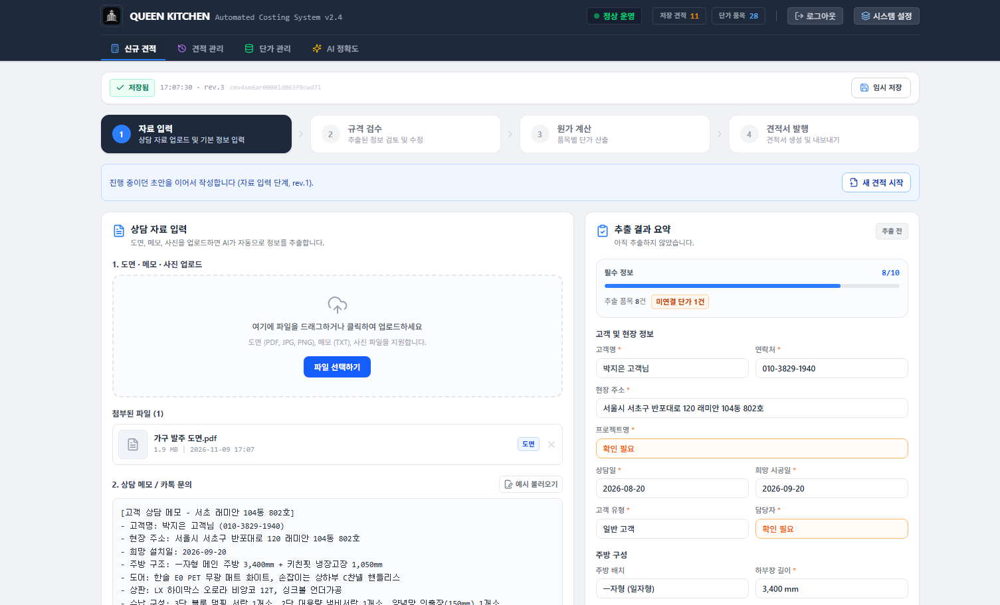
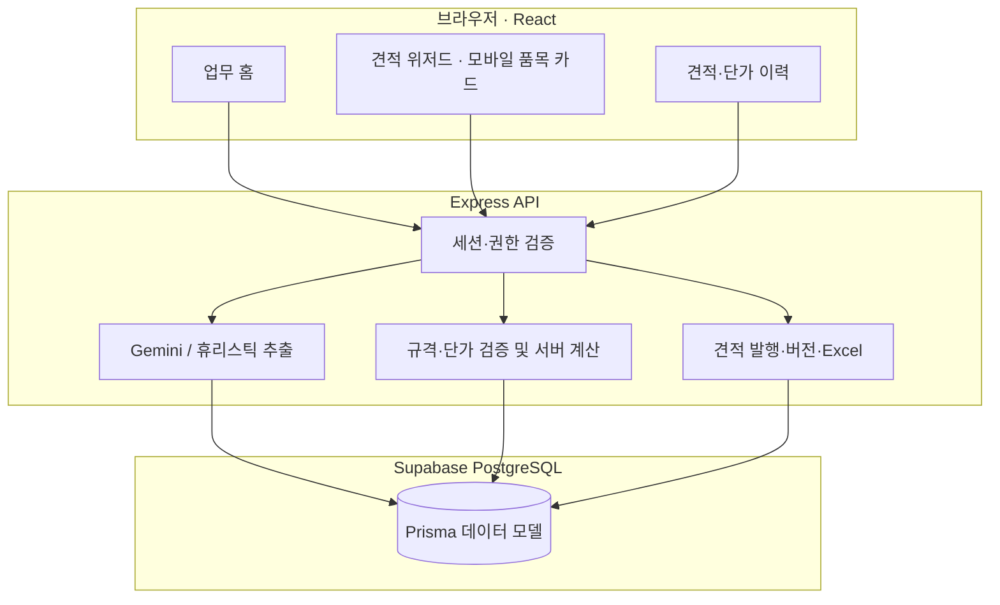
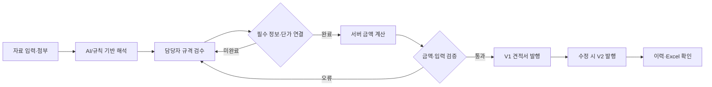
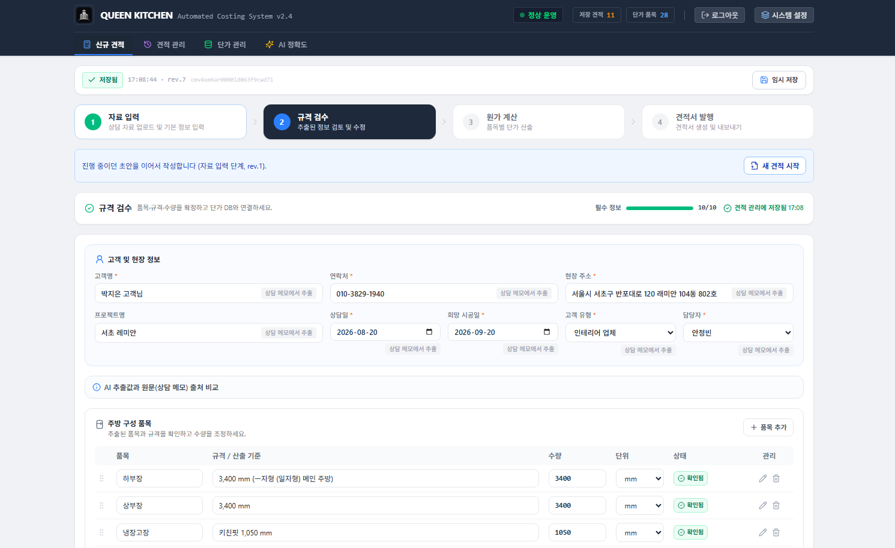
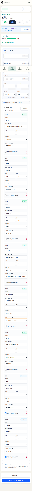
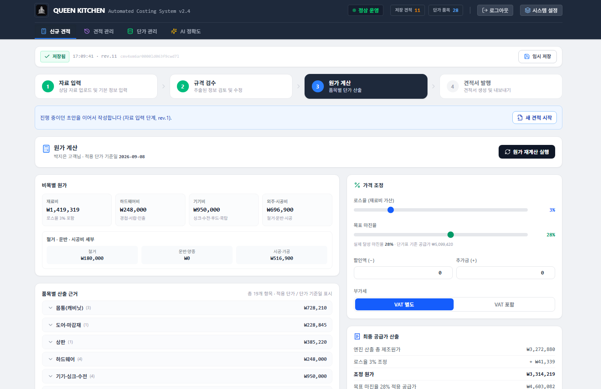
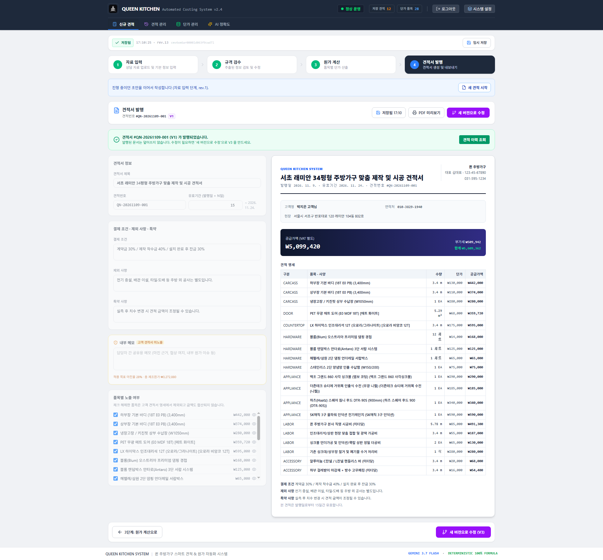
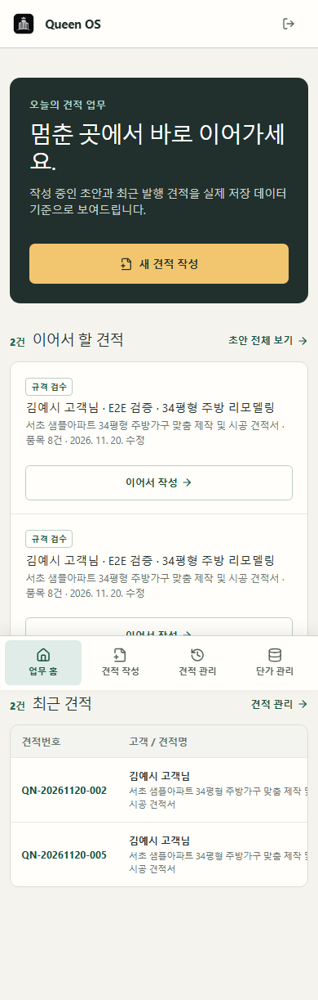
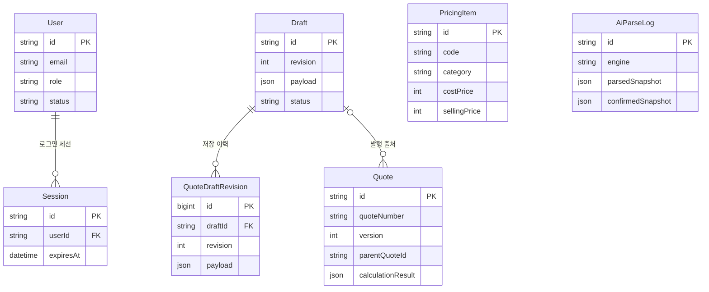

# Queen-OS

> **상담 자료에서 견적서까지, 가격과 판단의 근거를 남기다.**

주방가구 영업·설계 실무자가 상담 메모·사진·도면을 주문 정보로 정리하고, 규격·단가를 확인해 견적서를 발행하는 웹 기반 업무 도구입니다. AI는 자료 입력을 보조하고, **사람이 규격을 확정하며 서버가 가격을 계산**합니다.

<div align="center">

[](https://queen-os-theta.vercel.app/)
[](docs/기술규격서.md)
[](docs/quote-pricing-parity-2026-11-17.md)


<br>

<a href="https://queen-os-theta.vercel.app/">
  
</a>

</div>

**👤 담당** — 안정빈: 실무 문제 정의·서비스 기획·업무 흐름·정보 구조·검증 / AI 코딩 도구를 활용한 구현·개선

**🏢 업무 맥락** — 퀸주방가구 견적·상담·실측 업무 경험

| 견적 업무 단계 | 사용자 역할 | 주요 데이터 모델 | 통과한 자동 테스트 |
| :---: | :---: | :---: | :---: |
| **4단계** | **3종** | **7개** | **57개** |

| 📥 자료 입력 | 📐 규격 검수 | 🧮 금액 계산 | 📄 견적·이력 |
| :---: | :---: | :---: | :---: |
| **메모·사진·문서 통합** | **담당자 직접 확인** | **단가표 기반 산출** | **수정 버전 보존** |
| AI 추출 보조<br>휴리스틱 대체 경로<br>초안 저장·재개 | 누락 항목 확인<br>모바일 품목 카드<br>단가 DB 연결 | 원가·판매가·VAT<br>서버 재계산<br>변조·오류 차단 | V1 → V2 재발행<br>고객용 Excel<br>이력 및 접근 권한 |

<a id="contents"></a>
## 📑 목차

1. [📋 서비스 개요](#overview)
2. [🎯 기획 배경](#background)
3. [🏗️ 시스템 아키텍처](#architecture)
4. [✨ 주요 화면과 사용 흐름](#screens)
5. [🛡️ 견적 도메인 규칙](#rules)
6. [💡 기술적 의사결정](#decisions)
7. [📂 프로젝트 구조와 데이터 모델](#structure)
8. [🚀 실행 방법](#run)
9. [✅ 검증 결과](#verification)
10. [📈 회고와 다음 단계](#retrospective)
11. [📄 라이선스](#license)

<a id="overview"></a>
## 📋 1. 서비스 개요

| 항목 | 내용 |
| --- | --- |
| 해결할 문제 | 상담 자료 재입력, 규격·단가 검수 누락, 수기 금액 계산과 수정 견적 관리 |
| 주요 사용자 | 주방가구 영업·설계·견적 담당자, 관리자, 조회 전용 사용자 |
| 사용 환경 | 데스크톱·태블릿·모바일 브라우저, Vercel 웹앱, Express API, Supabase PostgreSQL |
| 제품 원칙 | **AI는 제안하고, 사람은 확정하고, 서버는 계산한다.** |
| 역할 | 문제 정의·업무 흐름·화면 기획·검증 및 AI 코딩 도구 기반 구현 |
| 업무 경계 | 상담·견적·실측 자료 관리에 집중. 확정 주문 이후의 회계·재고·매입/매출은 기존 업무 시스템과 분리 |

<a id="background"></a>
## 🎯 2. 기획 배경

주방가구 견적은 카카오톡 메시지, 손그림, 사진, 도면처럼 형식이 다른 자료에서 시작합니다. 주문 내용을 정리하는 사람과 견적을 검수하는 사람이 다르면 누락과 수정 이력 추적이 더 어려워집니다.

| 실무 문제 | 왜 중요한가 | Queen-OS의 해결 |
| --- | --- | --- |
| 여러 채널의 주문 자료 | 규격·수량을 반복 입력하면서 항목이 빠질 수 있음 | AI 보조 추출과 직접 입력을 하나의 검수 흐름으로 연결 |
| 단가표와 견적서의 분리 | 품목과 적용 단가가 다른 상태로 발행될 위험 | 검수 화면에서 단가 DB 품목을 명시적으로 연결 |
| 현장에서는 휴대전화 사용 | 데스크톱 표를 축소하면 규격·수량 수정이 어려움 | 820px 이하 하단 업무 메뉴와 품목별 편집 카드 |
| 금액과 버전의 불일치 | 수정 전 금액·근거를 나중에 확인하기 어려움 | 서버 측 계산 재검증과 V1·V2별 발행 스냅샷 보존 |

<a id="architecture"></a>
## 🏗️ 3. 시스템 아키텍처

<a id="stack"></a>
### 🧱 기술 스택

| 계층 | 기술 | 담당 기능 |
| --- | --- | --- |
| Frontend | React 19 · TypeScript · React Router · TanStack Query | 견적 4단계 위저드, 업무 홈, 이력·단가 화면 |
| Styling | Tailwind CSS · 자체 CSS | 데스크톱/모바일 레이아웃과 접근성 |
| Backend | Express 5 · Zod | 세션·권한·입력 검증·견적 발행 API |
| Calculation | TypeScript 계산 엔진 | 단가 스냅샷, 가격 조정, 마진, VAT 계산 |
| Database | PostgreSQL · Prisma 6 · Supabase | 품목 원가·판매가, 초안, 발행 문서, 사용자, 감사 기록 |
| AI | Gemini · 휴리스틱 파서 | 비정형 주문 자료 해석 보조 및 실패 시 대체 추출 |
| Quality/Deploy | Vitest · Vite · Vercel · GitHub | 테스트, 번들 빌드, Git 연동 배포 |



<a id="workflow"></a>
### 🔄 핵심 업무 플로우



<a id="screens"></a>
## ✨ 4. 주요 화면과 사용 흐름

<a id="input"></a>
### 📥 1단계 · 자료 입력


문서·사진·상담 메모를 입력하고 추출 결과를 확인합니다. AI 처리 실패 시 규칙 기반 파서를 활용할 수 있으며, 직접 입력으로도 이어서 작업할 수 있습니다.

<a id="review"></a>
### 📐 2단계 · 규격 검수



프로젝트명, 담당자, 규격·수량, 현장 조건을 검수하고 품목을 단가 DB에 연결합니다. 필수 정보나 단가 연결이 남아 있으면 다음 단계로 진행할 수 없습니다.

<p align="center">
  
</p>

모바일에서는 가로로 긴 품목표 대신 **품목 카드에서 이름·규격·수량·단위·카테고리·연결 단가**를 수정합니다.

<a id="calculation"></a>
### 🧮 3단계 · 원가 계산



원가·판매가·금액 조정과 부가세를 확인합니다. 화면에서 계산한 금액을 그대로 신뢰하지 않고, 발행 시 서버에서 입력 및 단가를 다시 검증합니다.

<a id="issue"></a>
### 📄 4단계 · 견적서 발행



확정한 견적은 발행 시점의 주문 정보와 계산 결과를 보존합니다. 수정 견적은 별도 V2 문서로 발행되며, 고객용 Excel 다운로드와 발행 이력 조회를 지원합니다.

<a id="history"></a>
### 🗂️ 견적 이력과 업무 홈

<p align="center">
  
  
</p>

업무 홈에서 새 견적이나 작성 중인 초안으로 이동합니다. 이력 화면에서는 견적 번호·고객·금액·버전을 확인하고 상세 문서를 열 수 있습니다. 원가 노출과 관리 작업은 계정 권한을 따릅니다.

<a id="rules"></a>
## 🛡️ 5. 견적 도메인 규칙

| 규칙 | 구현 기준 |
| --- | --- |
| AI와 확정 데이터의 분리 | 추출값은 초안이며, 규격·수량·단가는 실무자가 확인 |
| 가격의 단일 원본 | `server/calculationEngine.ts`의 규칙과 단가 DB를 기준으로 계산 |
| 서버 발행 검증 | 누락·잘못된 조정값·변조된 가격을 서버에서 거부 |
| 발행 문서 불변 | 수정은 기존 문서 덮어쓰기가 아니라 새 버전 발행 |
| 초안 복구 | 자동 저장, revision 충돌 감지, 이전 저장본 확인 |
| 고객용 정보 경계 | 고객용 Excel에서 내부 원가·마진 정보 제외 |
| 역할별 접근 | ADMIN · ESTIMATOR · VIEWER 권한을 서버에서 검사 |
| 자동 로그인 경계 | `DEMO_AUTO_LOGIN` 기본값 `false`; 활성화 시 비로그인 방문자가 관리자 권한을 얻으므로 격리된 시연 DB에서만 사용 |

<a id="decisions"></a>
## 💡 6. 기술적 의사결정

| 결정 항목 | 채택안 | 검토한 대안 | 선택 이유 |
| --- | --- | --- | --- |
| 견적 입력 | AI 제안 후 사람 검수 | AI 추출값 자동 확정 | 원본이 불완전해도 실무자가 누락·오인식을 바로잡을 수 있음 |
| 가격 산정 | 서버 결정론적 계산 | LLM 가격 추정·클라이언트 금액 신뢰 | 재현 가능성 및 가격 변조 방지 |
| 품목 입력 | 모바일 카드 + 데스크톱 표 | 모든 화면에서 넓은 표 유지 | 현장 휴대전화에서 한 품목의 필드를 직접 편집 가능 |
| 미완성 견적 | 서버 초안과 revision 기반 저장 | 브라우저 상태만 보존 | 새로고침 복구 및 변경 충돌 처리 |
| 수정 견적 | V1·V2 독립 발행 | 발행된 견적 덮어쓰기 | 기존 가격·계산 근거 보존 |
| 권한 | 서버 API별 인증·역할 검증 | 메뉴 숨기기만으로 제한 | URL·API 직접 접근도 제한 |
| 인프라 | Vercel + Supabase PostgreSQL | 별도 상시 서버 운영 | 기존 Git 배포와 데이터베이스 연결을 재사용 |

<a id="structure"></a>
## 📂 7. 프로젝트 구조와 데이터 모델

```text
src/
  App.tsx                             # 화면 라우팅
  components/
    WorkOverview.tsx                  # 업무 홈
    QuoteWizard.tsx                   # 견적 4단계
    wizard/review/KitchenItemsTable.tsx # 품목 검수 및 모바일 카드
    history/QuoteHistoryTable.tsx     # 견적 이력 표·모바일 카드
  hooks/useQuoteDraft.ts              # 초안 저장·복구
routes/
  auth.ts                             # 로그인
  drafts.ts                           # 임시 저장·수정 이력
  pricing.ts                          # 단가 카탈로그
  quotes.ts                           # 계산·발행·Excel
server/
  calculationEngine.ts                # 규칙 기반 금액 산출
  auth.ts                             # 세션 보안
prisma/
  schema.prisma                       # PostgreSQL 데이터 모델
  migrations/                         # DB 변경 이력
api/                                  # Vercel 서버 함수 진입점
docs/
  screenshots/                        # 주요 화면
  기술규격서.md
```

<a id="erd"></a>
### 🗄️ 핵심 데이터 모델



`PricingItem`은 단가 카탈로그이며, 견적에는 연결된 품목 식별자와 발행 시점의 계산·단가 스냅샷이 보존됩니다. 전체 모델은 [`prisma/schema.prisma`](prisma/schema.prisma)에 정의되어 있습니다.

<a id="run"></a>
## 🚀 8. 실행 방법

<a id="local"></a>
### 💻 로컬 실행

Node.js 20 이상과 접속 가능한 PostgreSQL 데이터베이스가 필요합니다.

```bash
npm ci
cp .env.example .env
# .env에 본인 환경의 DB URL과 필요한 서버 비밀 변수를 설정
npm run db:migrate:deploy
npm run dev:no-open
```

브라우저에서 `http://localhost:3000`에 접속합니다. 마이그레이션은 **직접 관리하는 DB에만** 실행하세요. 운영 DB에는 검토 없이 적용하지 않습니다.

| 환경 변수 | 필요 조건 | 용도 |
| --- | --- | --- |
| `DATABASE_URL` | DB 사용 시 필수 | Prisma 애플리케이션 연결 |
| `DIRECT_URL` | DB 마이그레이션 시 필수 | Prisma 직접 연결 |
| `SUPABASE_URL` · `SUPABASE_JWKS_URL` | 인증 설정에 따라 사용 | Supabase 인증 토큰 확인 |
| `SUPABASE_PUBLISHABLE_KEY` · `SUPABASE_SECRET_KEY` | 관련 서버 연동 시 사용 | Supabase API 접근; 비밀 키는 서버에서만 사용 |
| `GEMINI_API_KEY` | AI 추출을 사용할 때 | Gemini 요청; 미설정 시 대체 파서 경로 |
| `APP_URL` | 배포·리디렉션 설정 시 | 서버 공개 주소 |
| `DEMO_AUTO_LOGIN` | 기본 `false` | **관리자 자동 로그인**. 외부 공개 서비스에서는 활성화 금지 |

자세한 변수 형식은 [`.env.example`](.env.example)을 참조하세요. `.env`, DB 암호, API 비밀 키는 Git에 올리지 않습니다.

<a id="deployment"></a>
### ☁️ Vercel 배포

- GitHub `main` 브랜치가 기존 Vercel `queen-os` 프로젝트에 연결되어 있습니다.
- `npm run build`는 `prisma generate` 후 Vite 번들을 생성합니다.
- API 경로는 [`vercel.json`](vercel.json)에서 서버 함수로 연결합니다.
- **배포된 웹 화면이 보이는 것과 데이터베이스가 작동하는 것은 별개입니다.** Supabase 프로젝트가 중지되면 견적 저장·발행 API가 실패할 수 있습니다.

<a id="verification"></a>
## ✅ 9. 검증 결과

| 검증 대상 | 방법 | 확인된 결과 |
| --- | --- | --- |
| 단위·통합 | 격리 PostgreSQL에 연결해 `npm test` | **57/57 통과** |
| 발행 보안·정합성 | 독립 QA DB의 서버 API 시나리오 | **27/27 통과** — 가격 검증·권한·고객/내부 Excel |
| 모바일 업무 흐름 | Chromium 390×844, 실제 UI 조작 | 초안 복구 → 단가 연결 → 계산 → V1·V2 발행 → Excel·이력 확인 |
| 과거 버전 보존 | V1 후 V2 발행, API에서 V1 재조회 | V1 식별자·버전·금액 유지 |
| 반응형 레이아웃 | 320·390·768·1440px 홈, 390px 견적 4단계·이력 | 측정 화면에서 가로 페이지 넘침 없음 |
| 정적 분석·빌드 | TypeScript 검사, Vercel `prisma generate && vite build` | 통과. Vite 단일 번들 크기 경고는 남음 |
| 웹앱·API 진입점 | Vercel 공개 도메인 HTTP 요청 | `/`, `/wizard`, `/api/health` HTTP 200 |
| 외부 DB·로그인·견적 실사용 | 연결된 Supabase 및 공개 API 확인 | Supabase `queen-os`가 중지되어 견적 저장·발행 운영 검증 차단. 비로그인 견적 조회는 HTTP 401 |
| 실기기 사용자 평가 | iOS/Android 현장 사용성 검증 | 별도 검증 범위 |

검증 설계 및 계산 근거: [가격조정 정합성](docs/quote-pricing-parity-2026-11-17.md), [견적 발행 안전성](docs/견적-발행-안전성-검증-2026-11-17.md), [프로젝트 KPI](docs/프로젝트-KPI-정의서.md). **실제 고객의 견적 시간 단축이나 오류율 개선 수치는 아직 측정하지 않았습니다.**

<a id="retrospective"></a>
## 📈 10. 회고와 다음 단계

<a id="solved"></a>
### 🔧 해결한 문제

| 문제 | 원인 | 해결 |
| --- | --- | --- |
| 견적 미리보기·서버 발행 금액 차이 | 단계별 가격 조정 계산 분리 | 공통 계산 규칙과 서버 재검증 적용 |
| 수정 견적에서 과거 문서 혼선 | 발행 후 같은 문서 수정 | V1·V2 독립 발행 및 스냅샷 보존 |
| 모바일 품목 검수의 가로 스크롤 | 데스크톱 중심 테이블 | 품목별 편집 카드와 모바일 하단 내비게이션 |
| 작업 중 정보 유실 우려 | 화면 상태·동시 수정 충돌 | 서버 초안, 자동 저장, revision 검증 |

<a id="next"></a>
### 🗺️ 남은 중요한 문제

| 문제 | 왜 중요한가 | 다음 행동 |
| --- | --- | --- |
| Supabase 중지와 무료 활성 프로젝트 한도 | 공개 웹앱에서 견적 데이터를 저장할 수 없음 | 기존 프로젝트를 복구하거나 운영 DB 방안을 확정하고 실제 발행 테스트 |
| 현장 사용성의 실측 부재 | 자동 E2E 성공이 실제 직원의 작업 편의성을 보장하지 않음 | 직원에게 새 견적·단가 수정·V2 재발행 과제를 맡겨 성공률·막힌 지점 수집 |
| 외부 로그인·권한 종단 검증 | 테스트 계정 진입과 데이터 접근 범위를 실제 환경에서 검증해야 함 | 역할별 실로그인, API 접근, 쿠키 및 자동 로그인 설정 점검 |
| 모바일 파일 첨부·프린터 | 데스크톱 브라우저 자동 테스트만으로 현장 환경을 대체할 수 없음 | iOS Safari·Android Chrome 실기기 QA |
| 빌드 번들 크기 | 화면 진입 시 불필요한 코드 로딩 | 라우트별 코드 분할 후 로딩 측정 |

**Keep** — AI 결과와 검수값 분리, 가격의 서버 단일 원본, 버전 이력 보존.

**Problem** — 실제 업무 데이터와 현장 사용자 검증이 기능 테스트보다 뒤처져 있음.

**Try** — 실무자 파일럿에서 작업 성공·소요 시간·수정 요청을 기록해 다음 제품 우선순위를 결정.

<a id="license"></a>
## 📄 11. 라이선스

현재 이 저장소에는 별도의 `LICENSE` 파일과 공개 소프트웨어 라이선스가 없습니다. 별도의 이용 허락 없이 코드·디자인의 복제·재배포 권한이 부여되지 않습니다.

© 2026 안정빈. All rights reserved.
